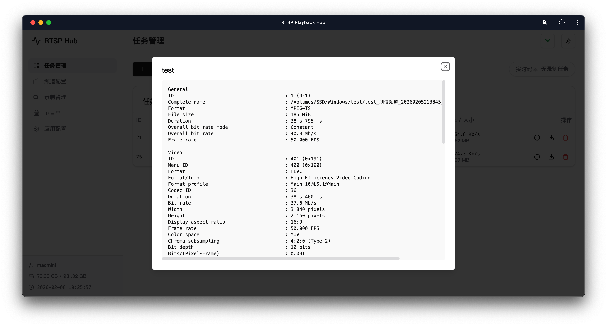

# RTSP 录制服务 (RtspRecServer)

一个基于 .NET 10 和 React 构建的高效 RTSP 回放流录制工具，提供现代化的 Web 管理界面。

> **⚠️ 免责声明**
>
> 本项目仅供学习和测试使用。开发者不对使用本软件产生的任何后果负责。请务必遵守当地法律法规，不得将本软件用于任何非法用途。

> **🤖 AI 生成声明**
>
> 本项目的所有代码（包括后端逻辑、前端界面及文档）均由 AI 辅助生成。代码质量可能参差不齐，仅供参考和实验，请勿对代码规范性抱有过高期待。

## ✨ 主要功能

- **RTSP 录制**：支持定时录制和手动录制。
- **直播录制**：支持 udpxy HTTP 单播、直接 RTP/UDP 组播直播源，按预约时间启动，录制中可修改结束时间。
- **TS 实时检测**：录制中分析同步、连续计数、PAT/PMT、PCR/PTS/DTS 和音视频 PID，任务表实时显示检测状态与编解码器，并默认写入同名 `.log` 日志。
- **频道检测**：内存流式采样约 5 秒，显示可访问性、全部音视频轨道编码、实时码率和 TS 检测结果；支持单条和批量检测，不写临时文件。
- **日志查看**：浏览器内查看每日运行日志和任务录制日志，支持自动刷新和下载。
- **M3U 导入**：支持拖入 `.m3u` / `.m3u8` 播放列表，本地解析后选择频道批量导入。
- **Web 管理界面**：提供直观的网页界面，默认跟随系统主题，可切换浅色/深色模式。
- **协议支持**：回放录制支持 MP2T/TCP 和 MP2T/RTP/TCP；直播源支持 udpxy HTTP、`rtp://` RTP 和 `udp://` 裸 MPEG-TS；RTP 支持短窗口乱序恢复和去重，同网卡、同端口频道共享 UDP 接收。
- **频道播放**：从频道列表复制播放链接、下载 M3U 或调用外部播放器。支持将 RTP、UDP、HTTP(S) MPEG-TS 和 IPTV RTSP 实时转发为 HTTP MPEG-TS，同频道的播放器共享上游连接。
- **EPG 电子节目表**：支持导入节目表。
- **低资源占用**：采用 NativeAOT 技术编译，启动快，占用低。

## 🛠️ 技术栈

- **后端**：.NET 10 (Minimal API)、System.Text.Json (Source Generator)
- **前端**：React 19、TypeScript、Vite、Tailwind CSS、Shadcn/ui
- **通信**：WebSocket (实时状态推送)
- **编译**：NativeAOT (提前编译为原生机器码)

## 📁 项目结构

```
.
├── src
│   ├── backend
│   │   ├── Server        后端服务入口与 API
│   │   └── Shared        共享模型与工具
│   └── frontend          前端管理界面
├── publish               发布输出目录
└── README.md
```

## 📸 界面截图




## 🚀 快速开始

### 运行环境

本软件为绿色版，解压即用。但在使用“查看信息”功能时，需要系统已安装以下工具：

- **MediaInfo**：用于读取录制文件的媒体信息（分辨率、码率等）。请确保 `mediainfo` 命令在系统环境变量中，或者与程序在同一目录下。

### 启动方式

1. 下载并解压程序包。
2. 双击运行主程序（`Server` 或 `Server.exe`）。
3. 在浏览器中访问管理页面（默认为 `http://localhost:8080`，端口可在 `recsettings.json` 中修改）。

## ⚙️ 简单配置

程序运行目录下有两个主要的配置文件，修改后重启程序生效。

### 1. 基础设置 (`recsettings.json`)

```json
{
    "port": 8080,              // Web 界面端口
    "host": ["0.0.0.0"],       // 监听地址，多个用逗号分隔（JSON 中为数组）
    "recordPath": "./records", // 录像保存路径
    "maxRecordingTasks": 1,    // 最大并发收流数，同源直播共用一条连接
    "maxRecordingWriters": 0,  // 最大同时写盘任务数，0 自动取 2 和收流上限中的较大值
    "recordingTransport": "MP2T/TCP", // 回放封装方式，仅 RTSP 回放使用
    "writeRecordingLog": true  // 是否在录像旁写入同名 .log
}
```

监听地址支持 IPv6：`::` 监听所有 IPv6 网卡（双栈系统上同时覆盖 IPv4，此时无需再配 `0.0.0.0`，两者同时配置会自动合并为单一 `::` 绑定）、`::1` 仅本机回环、也可填写具体 IPv6 地址或同时配置 IPv4 与 IPv6 地址（如 `"host": ["192.168.1.10", "::1"]`）。方括号写法 `[::1]` 会自动规范化，设置页修改后需重启服务生效。

### 2. 频道列表 (`channels.json`)

在这里添加 RTSP 回放地址或直播地址。直播地址可以是 udpxy 的 `http://.../rtp/组播地址:端口`、`http://.../udp/组播地址:端口`，也可以直接使用 `rtp://239.1.1.1:8000` 或 `udp://@239.1.1.1:8000`。多网卡环境可在直接组播地址后追加 `?localaddr=本机地址` 指定接收网卡。

```json
[
  {
    "id": 0,
    "name": "CCTV-1",
    "url": "rtsp://example.com/stream1"
  },
  {
    "id": 1,
    "name": "CCTV-2 直播",
    "url": "http://udpxy.example.com:5140/rtp/239.1.1.1:8000"
  }
]
```

直播任务按预约开始时间启动；开始时间已过但尚未到结束时间时会立即补录。结束时间可在任务列表中随时修改，延长会继续写入当前文件。未填写任务名称时，回放任务默认以 `Playback_` 开头，直播任务默认以 `Live_` 开头；直播文件名只带开始时间，回放文件名同时带开始和结束时间。直接 RTP/UDP 地址会按 URL 协议接收组播流。

同一 RTP、UDP 或 udpxy HTTP 源的重叠直播任务会共用一路收流，各自写独立录像并检查 TS。并发收流数设为 1 时，只要仍有写盘名额，后来开始的同源任务就能加入。RTSP 回放任务各占一路收流。

频道右侧的播放菜单使用 `/api/channels/{id}/play.ts` 转发当前保存的地址，沿用服务访问认证。HTTP(S) 输入须是连续 MPEG-TS 流。RTSP 播放使用频道原始地址及设置里的 MP2T/TCP 或 MP2T/RTP/TCP 封装，要求该地址可直接发起播放。播放在内存中转发，最后一个播放器退出后释放上游。

## 📄 许可证

本项目采用 GNU General Public License v3.0，详见 [LICENSE](./LICENSE)。

部分 TS 检测能力适配自同作者的 [TSCutter.GUI](https://github.com/nilaoda/TSCutter.GUI)。

组播绑定和 RTP 顺序收流的设计参考了 [msd_lite](https://github.com/rozhuk-im/msd_lite) 和 [rtp2httpd](https://github.com/stackia/rtp2httpd)。Linux 按组播地址绑定和批量读取的设计参考了 [TVHeadend](https://github.com/tvheadend/tvheadend)。本项目使用 C# 独立实现。
